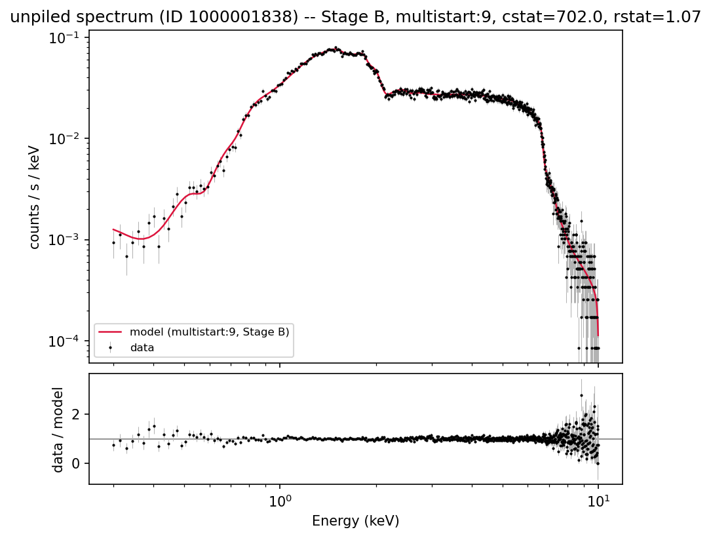
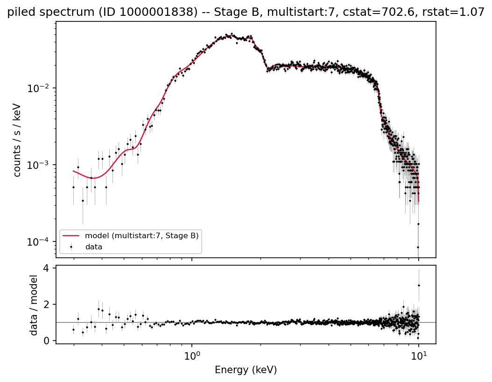
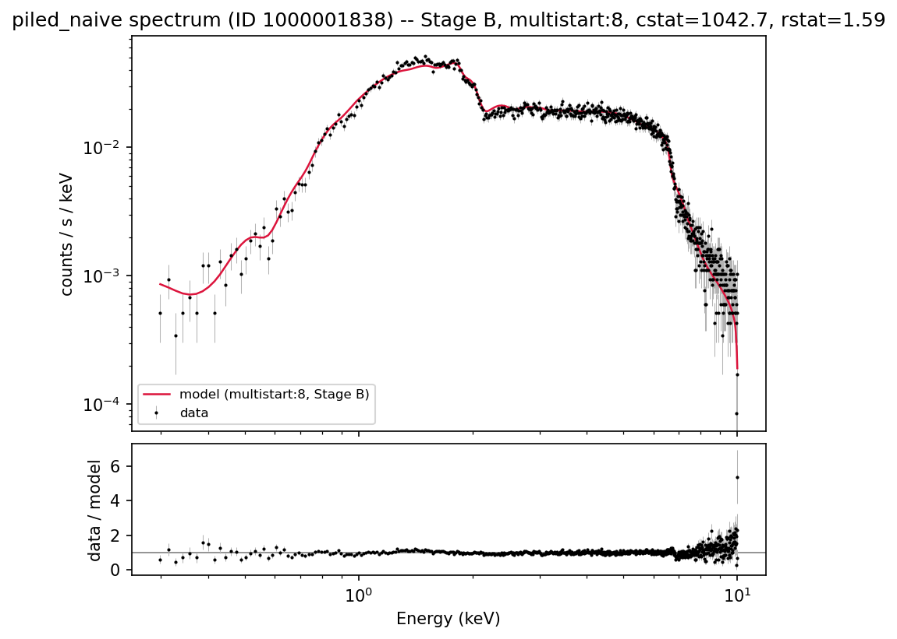

# Fit metrics report -- relxill fit of spectrum ID 1000001838

Generated from `results/id1000001838/fits_raw.json`, `results/id1000001838/analysis_summary.json`, and `results/id1000001838/conf_flagship.json` by `scripts/write_report.py`. See `CLAUDE.md` for the full methodology (Phases 1-5); this document reports results only.

**Ground truth for this simulation** (from `v0017_800ks_index.csv`): spin=0.4153, incl=26.20 deg, gamma=1.3947, logxi=2.3851, Afe=7.3213, refl_frac=6.5860, nH=0.6491. `norm` (=0.00359) is intentionally excluded from all comparisons below -- Phase 3 found a large (~50x), uniform flux-normalization mismatch between our relxill/response setup and whatever convention the original simulation used, so raw `norm` values are not on a comparable scale.

## Stage definitions

- **Stage A**: all thawed (except z=0)
- **Stage B**: standard freeze (Rin=-1 ISCO, Rout=400, single emissivity, Ecut=300)
- **Stage C**: Stage B + Afe=1 (solar)
- **Stage D**: Stage C + Incl fixed at ground truth (~26.2 deg)

## Three spectrum/model cases compared

- **unpiled**: the pileup-free spectrum, fit with `tbabs*relxill`.
- **piled**: the pileup-affected spectrum, fit with `tbabs*relxill` wrapped in Sherpa's `jdpileup` model -- the physically correct treatment.
- **piled_naive**: the *same* pileup-affected spectrum, fit with plain `tbabs*relxill` and **no** pileup correction at all -- the mistake an analyst makes by not realizing/correcting for pileup. Added specifically to quantify how much parameter bias pileup causes *with* vs. *without* correcting for it (see the three-way comparison immediately below).

## Headline result: Stage B, all three cases vs. ground truth

This is the comparison of primary interest -- the literature-standard freezing stage, for all three spectrum/model cases, each using its **multi-start flagship** fit (lowest-cstat solution with refl_frac > 0 over the grid and `run_multistart.py`; see "Multi-start check" below for why the fixed-start grid's own best can't be used here). Flagship sources/cstat: unpiled = multistart:9, cstat 702.0; piled = multistart:7, cstat 702.6; piled_naive = multistart:8, cstat 1042.7.

| Parameter | Ground truth | unpiled | piled (corrected) | piled_naive (uncorrected) |
|---|---|---|---|---|
| spin (a) | 0.415 | 0.469 (12.8%) | 0.492 (18.3%) | -0.336 (-180.8%) |
| Incl (deg) | 26.200 | 27.639 (5.5%) | 28.075 (7.2%) | 24.827 (-5.2%) |
| gamma | 1.395 | 1.250 (-10.4%) | 1.235 (-11.4%) | 1.400 (0.4%) |
| logxi | 2.385 | 2.506 (5.1%) | 2.541 (6.5%) | 0.000 (-100.0%) |
| Afe | 7.321 | 9.999 (36.6%) | 9.505 (29.8%) | 0.500 (-93.2%) |
| refl_frac | 6.586 | 6.355 (-3.5%) | 6.640 (0.8%) | 15.166 (130.3%) |
| nH (1e22 cm^-2) | 0.649 | 0.579 (-10.8%) | 0.591 (-9.0%) | 0.494 (-23.9%) |

**Read this as**: `unpiled` is the baseline (pileup-free, closest to a "clean" measurement); `piled` shows what you get *after* correcting for pileup with `jdpileup`; `piled_naive` shows what you'd get if you fit the exact same pileup-affected data *without* realizing/correcting for pileup. See "Interpretation" after the table.

## Unpiled spectrum

| Stage | Method | Converged | cstat | dof | reduced stat | nfev | wall time (s) |
|---|---|---|---|---|---|---|---|
| A | levmar | True | 1216.6 | 651 | 1.87 | 750 | 4.6 |
| A | neldermead | True | 695.5 | 651 | 1.07 | 5590 | 32.9 |
| A | moncar | **CRASHED** | -- | -- | -- | -- | 58.1 |
| B | levmar | True | 733.6 | 657 | 1.12 | 244 | 1.2 |
| B | neldermead | True | 874.7 | 657 | 1.33 | 3198 | 17.5 |
| B | moncar | False | 875.0 | 657 | 1.33 | 5600 | 30.5 |
| C | levmar | True | 1244.5 | 658 | 1.89 | 443 | 2.1 |
| C | neldermead | True | 1238.1 | 658 | 1.88 | 2791 | 15.5 |
| C | moncar | False | 1238.3 | 658 | 1.88 | 4900 | 26.2 |
| D | levmar | True | 1272.7 | 659 | 1.93 | 488 | 2.2 |
| D | neldermead | True | 1265.3 | 659 | 1.92 | 2031 | 10.9 |
| D | moncar | False | 1265.3 | 659 | 1.92 | 4200 | 20.6 |

Stage A: 1 of 3 optimizers crashed/timed out on this spectrum (relxill hard-aborts on unphysical Rout<=Rin excursions -- see CLAUDE.md Phase 4).

### unpiled: recovered parameters vs. ground truth, by stage

Each table uses that stage's best formally-converged fit (see method column); covar 1-sigma errors turn into `n_sigma` below (not a systematic-bias measure -- see the conf-vs-covar section for why these can be misleadingly tight).

**Stage A** (method: neldermead, cstat=695.5, rstat=1.07):

| Parameter | Fitted | Ground truth | Relative diff | n_sigma (covar) |
|---|---|---|---|---|
| spin (a) | 0.915 | 0.415 | 120.3% | 45.5 |
| Incl (deg) | 28.074 | 26.200 | 7.2% | 2.0 |
| gamma | 1.266 | 1.395 | -9.2% | -7.1 |
| logxi | 2.498 | 2.385 | 4.7% | 2.0 |
| Afe | 10.000 | 7.321 | 36.6% | -- |
| refl_frac | 6.437 | 6.586 | -2.3% | -0.8 |
| nH (1e22 cm^-2) | 0.577 | 0.649 | -11.1% | -7.5 |

**Stage B** (method: levmar, cstat=733.6, rstat=1.12):

| Parameter | Fitted | Ground truth | Relative diff | n_sigma (covar) |
|---|---|---|---|---|
| spin (a) | 0.494 | 0.415 | 18.9% | 1.5 |
| Incl (deg) | 27.964 | 26.200 | 6.7% | 3.6 |
| gamma | 1.402 | 1.395 | 0.6% | 0.5 |
| logxi | 2.358 | 2.385 | -1.1% | -0.8 |
| Afe | 7.595 | 7.321 | 3.7% | 0.3 |
| refl_frac | 8.932 | 6.586 | 35.6% | 6.4 |
| nH (1e22 cm^-2) | 0.640 | 0.649 | -1.4% | -0.4 |

**Stage C** (method: neldermead, cstat=1238.1, rstat=1.88):

| Parameter | Fitted | Ground truth | Relative diff | n_sigma (covar) |
|---|---|---|---|---|
| spin (a) | -0.376 | 0.415 | -190.6% | -19.4 |
| Incl (deg) | 23.848 | 26.200 | -9.0% | -7.6 |
| gamma | 2.000 | 1.395 | 43.4% | -- |
| logxi | 0.000 | 2.385 | -100.0% | -- |
| Afe | (frozen / n/a) | -- | -- | -- |
| refl_frac | 37.227 | 6.586 | 465.2% | 56.8 |
| nH (1e22 cm^-2) | 0.605 | 0.649 | -6.8% | -11.5 |

**Stage D** (method: neldermead, cstat=1265.3, rstat=1.92):

| Parameter | Fitted | Ground truth | Relative diff | n_sigma (covar) |
|---|---|---|---|---|
| spin (a) | -0.299 | 0.415 | -171.9% | -11.4 |
| Incl (deg) | (frozen / n/a) | -- | -- | -- |
| gamma | 2.000 | 1.395 | 43.4% | -- |
| logxi | 0.000 | 2.385 | -100.0% | -- |
| Afe | (frozen / n/a) | -- | -- | -- |
| refl_frac | 37.967 | 6.586 | 476.5% | 71.1 |
| nH (1e22 cm^-2) | 0.605 | 0.649 | -6.9% | -27.0 |

### unpiled: cross-method agreement, by stage

Where 2+ methods formally converged in the same (spectrum, stage) group, the spread between their recovered parameter values (as a fraction of the largest value) -- a large spread means the methods landed in *different* minima, not just different precision on the same one.

**Stage A**:

Converged methods compared: levmar, neldermead

| Parameter | Max relative spread across methods |
|---|---|
| Rbr | 98.7% |
| refl_frac | 55.1% |
| Ecut | 54.0% |
| Afe | 50.6% |
| Rin | 47.6% |
| Index2 | 43.2% |
| Rout | 35.7% |
| nH | 31.6% |
| Incl | 17.6% |
| logxi | 14.8% |
| a | 8.5% |
| gamma | 3.2% |
| Index1 | 2.3% |
| norm | 0.5% |

**Stage B**:

Converged methods compared: levmar, neldermead

| Parameter | Max relative spread across methods |
|---|---|
| logxi | 87.2% |
| Afe | 58.5% |
| refl_frac | 55.4% |
| a | 30.0% |
| gamma | 22.1% |
| nH | 6.6% |
| norm | 3.5% |
| Incl | 0.1% |

**Stage C**:

Converged methods compared: levmar, neldermead

| Parameter | Max relative spread across methods |
|---|---|
| logxi | 100.0% |
| a | 8.9% |
| refl_frac | 2.8% |
| nH | 1.8% |
| gamma | 1.4% |
| norm | 0.5% |
| Incl | 0.2% |

**Stage D**:

Converged methods compared: levmar, neldermead

| Parameter | Max relative spread across methods |
|---|---|
| logxi | 100.0% |
| a | 11.5% |
| refl_frac | 5.4% |
| gamma | 2.1% |
| nH | 2.0% |
| norm | 0.6% |

## Piled spectrum (jdpileup-corrected)

| Stage | Method | Converged | cstat | dof | reduced stat | nfev | wall time (s) |
|---|---|---|---|---|---|---|---|
| A | levmar | **CRASHED** | -- | -- | -- | -- | 7.3 |
| A | neldermead | **CRASHED** | -- | -- | -- | -- | 60.0 |
| A | moncar | False | 792.1 | 649 | 1.22 | 11200 | 97.6 |
| B | levmar | True | 970.3 | 655 | 1.48 | 354 | 2.7 |
| B | neldermead | True | 1117.1 | 655 | 1.71 | 3990 | 42.0 |
| B | moncar | False | 1065.2 | 655 | 1.63 | 7000 | 81.9 |
| C | levmar | True | 841.2 | 656 | 1.28 | 232 | 2.4 |
| C | neldermead | True | 1202.8 | 656 | 1.83 | 3205 | 38.0 |
| C | moncar | False | 1202.8 | 656 | 1.83 | 6300 | 76.1 |
| D | levmar | True | 851.3 | 657 | 1.30 | 255 | 2.2 |
| D | neldermead | True | 1203.3 | 657 | 1.83 | 2794 | 32.1 |
| D | moncar | False | 1203.4 | 657 | 1.83 | 5600 | 62.3 |

Stage A: 2 of 3 optimizers crashed/timed out on this spectrum (relxill hard-aborts on unphysical Rout<=Rin excursions -- see CLAUDE.md Phase 4).

### piled: recovered parameters vs. ground truth, by stage

Each table uses that stage's best formally-converged fit (see method column); covar 1-sigma errors turn into `n_sigma` below (not a systematic-bias measure -- see the conf-vs-covar section for why these can be misleadingly tight).

**Stage A** (method: moncar, cstat=792.1, rstat=1.22):

| Parameter | Fitted | Ground truth | Relative diff | n_sigma (covar) |
|---|---|---|---|---|
| spin (a) | 0.992 | 0.415 | 138.9% | -- |
| Incl (deg) | 19.670 | 26.200 | -24.9% | -5.8 |
| gamma | 1.032 | 1.395 | -26.0% | -34.6 |
| logxi | 3.002 | 2.385 | 25.8% | 141.4 |
| Afe | 4.022 | 7.321 | -45.1% | -12.4 |
| refl_frac | 42.753 | 6.586 | 549.1% | 2.9 |
| nH (1e22 cm^-2) | 0.808 | 0.649 | 24.5% | 17.0 |

**Stage B** (method: levmar, cstat=970.3, rstat=1.48):

| Parameter | Fitted | Ground truth | Relative diff | n_sigma (covar) |
|---|---|---|---|---|
| spin (a) | 0.968 | 0.415 | 133.0% | 32.7 |
| Incl (deg) | 24.588 | 26.200 | -6.2% | -2.4 |
| gamma | 1.247 | 1.395 | -10.6% | -23.4 |
| logxi | 2.926 | 2.385 | 22.7% | 27.0 |
| Afe | 3.407 | 7.321 | -53.5% | -37.1 |
| refl_frac | -16.777 | 6.586 | -354.7% | -119.8 |
| nH (1e22 cm^-2) | 0.864 | 0.649 | 33.1% | 29.2 |

**Stage C** (method: levmar, cstat=841.2, rstat=1.28):

| Parameter | Fitted | Ground truth | Relative diff | n_sigma (covar) |
|---|---|---|---|---|
| spin (a) | -0.188 | 0.415 | -145.2% | -9.4 |
| Incl (deg) | 25.771 | 26.200 | -1.6% | -1.1 |
| gamma | 1.800 | 1.395 | 29.1% | 145.5 |
| logxi | 0.021 | 2.385 | -99.1% | -- |
| Afe | (frozen / n/a) | -- | -- | -- |
| refl_frac | 29.251 | 6.586 | 344.1% | 32.4 |
| nH (1e22 cm^-2) | 0.573 | 0.649 | -11.8% | -9.0 |

**Stage D** (method: levmar, cstat=851.3, rstat=1.30):

| Parameter | Fitted | Ground truth | Relative diff | n_sigma (covar) |
|---|---|---|---|---|
| spin (a) | -0.166 | 0.415 | -139.9% | -12.6 |
| Incl (deg) | (frozen / n/a) | -- | -- | -- |
| gamma | 1.806 | 1.395 | 29.5% | 12.1 |
| logxi | 0.000 | 2.385 | -100.0% | -- |
| Afe | (frozen / n/a) | -- | -- | -- |
| refl_frac | 29.623 | 6.586 | 349.8% | 8.9 |
| nH (1e22 cm^-2) | 0.572 | 0.649 | -11.8% | -8.8 |

### piled: cross-method agreement, by stage

Where 2+ methods formally converged in the same (spectrum, stage) group, the spread between their recovered parameter values (as a fraction of the largest value) -- a large spread means the methods landed in *different* minima, not just different precision on the same one.

**Stage A**:

(fewer than 2 converged methods for piled/A; no comparison)

**Stage B**:

Converged methods compared: levmar, neldermead

| Parameter | Max relative spread across methods |
|---|---|
| refl_frac | 160.5% |
| a | 158.2% |
| norm | 97.6% |
| alpha | 82.1% |
| Afe | 80.3% |
| logxi | 55.6% |
| nH | 47.0% |
| f | 5.5% |
| gamma | 3.8% |
| Incl | 1.0% |

**Stage C**:

Converged methods compared: levmar, neldermead

| Parameter | Max relative spread across methods |
|---|---|
| logxi | 97.9% |
| norm | 92.2% |
| refl_frac | 67.2% |
| alpha | 66.3% |
| gamma | 33.3% |
| nH | 19.9% |
| a | 10.1% |
| f | 6.8% |
| Incl | 3.1% |

**Stage D**:

Converged methods compared: levmar, neldermead

| Parameter | Max relative spread across methods |
|---|---|
| logxi | 100.0% |
| norm | 98.8% |
| alpha | 81.8% |
| refl_frac | 67.7% |
| gamma | 33.5% |
| nH | 19.9% |
| a | 7.5% |
| f | 5.5% |

## Piled spectrum, fit WITHOUT correcting for pileup ("piled_naive")

| Stage | Method | Converged | cstat | dof | reduced stat | nfev | wall time (s) |
|---|---|---|---|---|---|---|---|
| A | levmar | True | 1106.9 | 651 | 1.70 | 459 | 3.9 |
| A | neldermead | **CRASHED** | -- | -- | -- | -- | 32.2 |
| A | moncar | **CRASHED** | -- | -- | -- | -- | 55.3 |
| B | levmar | True | 1075.0 | 657 | 1.64 | 245 | 1.2 |
| B | neldermead | True | 1075.1 | 657 | 1.64 | 3190 | 15.6 |
| B | moncar | False | 1059.2 | 657 | 1.61 | 5600 | 30.3 |
| C | levmar | True | 1140.7 | 658 | 1.73 | 234 | 1.1 |
| C | neldermead | True | 1196.1 | 658 | 1.82 | 2198 | 12.5 |
| C | moncar | False | 1140.8 | 658 | 1.73 | 4900 | 25.2 |
| D | levmar | True | 1143.8 | 659 | 1.74 | 164 | 0.8 |
| D | neldermead | True | 1196.7 | 659 | 1.82 | 1389 | 7.7 |
| D | moncar | False | 1198.4 | 659 | 1.82 | 4210 | 25.8 |

Stage A: 2 of 3 optimizers crashed/timed out on this spectrum (relxill hard-aborts on unphysical Rout<=Rin excursions -- see CLAUDE.md Phase 4).

### piled_naive: recovered parameters vs. ground truth, by stage

Each table uses that stage's best formally-converged fit (see method column); covar 1-sigma errors turn into `n_sigma` below (not a systematic-bias measure -- see the conf-vs-covar section for why these can be misleadingly tight).

**Stage A** (method: levmar, cstat=1106.9, rstat=1.70):

| Parameter | Fitted | Ground truth | Relative diff | n_sigma (covar) |
|---|---|---|---|---|
| spin (a) | 0.977 | 0.415 | 135.3% | -- |
| Incl (deg) | 23.888 | 26.200 | -8.8% | -- |
| gamma | 1.332 | 1.395 | -4.5% | -- |
| logxi | 2.593 | 2.385 | 8.7% | -- |
| Afe | 2.059 | 7.321 | -71.9% | -- |
| refl_frac | 25.422 | 6.586 | 286.0% | -- |
| nH (1e22 cm^-2) | 0.716 | 0.649 | 10.3% | -- |

**Stage B** (method: levmar, cstat=1075.0, rstat=1.64):

| Parameter | Fitted | Ground truth | Relative diff | n_sigma (covar) |
|---|---|---|---|---|
| spin (a) | 0.473 | 0.415 | 13.9% | 1.8 |
| Incl (deg) | 26.734 | 26.200 | 2.0% | 0.4 |
| gamma | 1.238 | 1.395 | -11.2% | -20.7 |
| logxi | 2.663 | 2.385 | 11.7% | 7.4 |
| Afe | 1.975 | 7.321 | -73.0% | -26.4 |
| refl_frac | 18.791 | 6.586 | 185.3% | 5.9 |
| nH (1e22 cm^-2) | 0.694 | 0.649 | 7.0% | 3.2 |

**Stage C** (method: levmar, cstat=1140.7, rstat=1.73):

| Parameter | Fitted | Ground truth | Relative diff | n_sigma (covar) |
|---|---|---|---|---|
| spin (a) | 0.379 | 0.415 | -8.6% | -- |
| Incl (deg) | 24.809 | 26.200 | -5.3% | -- |
| gamma | 1.263 | 1.395 | -9.5% | -48.5 |
| logxi | 2.560 | 2.385 | 7.3% | 7.7 |
| Afe | (frozen / n/a) | -- | -- | -- |
| refl_frac | 25.238 | 6.586 | 283.2% | -- |
| nH (1e22 cm^-2) | 0.712 | 0.649 | 9.7% | -- |

**Stage D** (method: levmar, cstat=1143.8, rstat=1.74):

| Parameter | Fitted | Ground truth | Relative diff | n_sigma (covar) |
|---|---|---|---|---|
| spin (a) | 0.444 | 0.415 | 7.0% | 0.3 |
| Incl (deg) | (frozen / n/a) | -- | -- | -- |
| gamma | 1.267 | 1.395 | -9.1% | -10.2 |
| logxi | 2.556 | 2.385 | 7.1% | 7.9 |
| Afe | (frozen / n/a) | -- | -- | -- |
| refl_frac | 27.659 | 6.586 | 320.0% | 3.7 |
| nH (1e22 cm^-2) | 0.717 | 0.649 | 10.5% | 5.3 |

### piled_naive: cross-method agreement, by stage

Where 2+ methods formally converged in the same (spectrum, stage) group, the spread between their recovered parameter values (as a fraction of the largest value) -- a large spread means the methods landed in *different* minima, not just different precision on the same one.

**Stage A**:

(fewer than 2 converged methods for piled_naive/A; no comparison)

**Stage B**:

Converged methods compared: levmar, neldermead

| Parameter | Max relative spread across methods |
|---|---|
| a | 1.7% |
| refl_frac | 1.2% |
| Afe | 0.4% |
| Incl | 0.2% |
| nH | 0.1% |
| norm | 0.1% |
| logxi | 0.1% |
| gamma | 0.1% |

**Stage C**:

Converged methods compared: levmar, neldermead

| Parameter | Max relative spread across methods |
|---|---|
| a | 143.5% |
| refl_frac | 61.9% |
| logxi | 60.9% |
| nH | 35.8% |
| Incl | 6.7% |
| norm | 5.9% |
| gamma | 5.0% |

**Stage D**:

Converged methods compared: levmar, neldermead

| Parameter | Max relative spread across methods |
|---|---|
| a | 140.3% |
| refl_frac | 65.4% |
| logxi | 60.9% |
| nH | 36.2% |
| norm | 6.4% |
| gamma | 5.3% |

## conf vs. covar: flagship comparison (Stage B)

Sherpa's `covar` (covariance/Hessian-based, fast) vs. `conf` (profile-likelihood, expensive -- re-optimizes remaining free parameters at each trial value) 1-sigma intervals, for the best-converged Stage B fit of each spectrum.

### unpiled (method: levmar, cstat=702.0, rstat=1.07)

`covar` wall time: 0.5s -- `conf` wall time: 78.9s (164x slower)

| Parameter | Best fit | covar 1-sigma | conf 1-sigma |
|---|---|---|---|
| nH | 0.579 | [-0.003911, +0.003911] | [-0.004576, +0.005683] |
| a | 0.4686 | [-0.01914, +0.01914] | [-0.0232, +0.01953] |
| Incl | 27.64 | [-0.3615, +0.3615] | [-0.3109, +0.293] |
| gamma | 1.25 | [-0.009382, +0.009382] | [-0.008795, +0.01339] |
| logxi | 2.506 | [-0.03816, +0.03816] | [-0.03888, +0.03302] |
| Afe | 10 | undefined | [-0.2604, (boundary)] |
| refl_frac | 6.353 | [-0.09854, +0.09854] | [-0.09854, +0.145] |
| norm | 7.315e-05 | [-3.473e-07, +3.473e-07] | [-3.195e-07, +3.308e-07] |

### piled (method: levmar, cstat=700.8, rstat=1.07)

`covar` wall time: 1.6s -- `conf` wall time: 308.2s (198x slower)

| Parameter | Best fit | covar 1-sigma | conf 1-sigma |
|---|---|---|---|
| alpha | 0.1147 | [-0.01511, +0.01511] | [-0.02553, +0.01512] |
| f | 0.9191 | [-0.000392, +0.000392] | [-0.0003828, +0.0003629] |
| nH | 0.5879 | [-0.01047, +0.01047] | [-0.006388, +0.01764] |
| a | 0.5014 | [-0.09399, +0.09399] | [-0.03488, +0.02899] |
| Incl | 28.14 | [-1.245, +1.245] | [-0.4806, +0.5025] |
| gamma | 1.235 | [-0.05357, +0.05357] | [-0.006195, +0.04474] |
| logxi | 2.538 | [-0.2901, +0.2901] | [-0.05426, +0.05726] |
| Afe | 10 | undefined | [-0.5457, (boundary)] |
| refl_frac | 6.521 | [-0.2, +0.2] | [-0.1495, +0.5139] |
| norm | 0.0004291 | [-7.85e-05, +7.85e-05] | [-0.000165, +5.039e-05] |

### piled_naive (method: levmar, cstat=1042.7, rstat=1.59)

`covar` wall time: 0.6s -- `conf` wall time: 52.7s (90x slower)

| Parameter | Best fit | covar 1-sigma | conf 1-sigma |
|---|---|---|---|
| nH | 0.494 | [-0.005412, +0.005412] | [-0.004228, +0.004913] |
| a | -0.3357 | [-0.08701, +0.08701] | [-0.06973, +0.08002] |
| Incl | 24.83 | [-0.6488, +0.6488] | [-0.7544, +0.5214] |
| gamma | 1.4 | undefined | [-0.002578, +0.006201] |
| logxi | 1.024e-05 | undefined | [(boundary), +0.01973] |
| Afe | 0.5 | undefined | [(boundary), +0.01209] |
| refl_frac | 15.17 | [-0.2882, +0.2882] | [-0.2084, +0.2862] |
| norm | 5.423e-05 | [-2.644e-07, +2.644e-07] | [-1.983e-07, +2.105e-07] |

## Multi-start check of Stage B (new for this ID)

The grid tables above use one fixed starting point for every fit (the
Phase 4 protocol, identical to ID 1000000081's). For this ID that was not
enough: the jdpileup-corrected **Stage C** fit (Afe frozen at 1, i.e. a
*subset* of Stage B's parameter space) reached cstat 841.2, below *every*
Stage B fit (best 970.3, `levmar`). That's impossible if the Stage B searches had
found Stage B's minimum. Worse, that 970.3 "best" Stage B fit has
`refl_frac = -16.8`, which in relxill selects the **reflection-only** model
branch (no primary continuum), a qualitatively different model.

`scripts/run_multistart.py` therefore reruns Stage B for each case from 18
starting points: a coarse, truth-agnostic lattice (a in {0, 0.5, 0.9} x
logxi in {1, 2.5} x Afe in {1, 5}) plus 6 seeds taken from the grid's own
Stage C/D end points. Each run is `levmar` then a `neldermead` polish, in
its own subprocess. The **flagship** Stage B fit of each case is the
lowest-cstat *physical* (`refl_frac > 0`) solution among all grid and
multi-start fits (`target.flagship_records()`); the headline three-way
table, conf/covar comparison and plots all use these flagship fits.

| Case | Grid best Stage B (fixed start) | Multi-start flagship | Distinct minima seen (cstat) |
|---|---|---|---|
| unpiled | 733.6 (`levmar`) | **702.0** (lattice start 9; start 11 agrees to 0.002) | ~702, ~709, ~731-734, ~875 |
| piled (jdpileup) | 970.3 (`levmar`, refl_frac<0 -- unphysical) | **702.6** (lattice start 7) | ~703-706, ~731-737, ~759-766, ~855, ~1049-1116 |
| piled_naive | 1059.2 (`moncar`, not converged) | **1042.7** (lattice start 8; four other starts within 0.12) | ~1043-1048, ~1075 |

All 54 multi-start fits completed; none crashed. The grid-derived seeds
never beat the lattice. Starting where a *more constrained* stage ended
up is not a substitute for spreading starts across parameter space.

## Interpretation: what changes at moderate pileup?

- **At ~30% count loss, `jdpileup` works.** The corrected piled flagship
  (cstat 702.6, reduced 1.07) is statistically indistinguishable from the
  unpiled flagship (702.0, 1.07). Its parameters track the unpiled ones
  closely: spin 0.49 vs 0.47 (truth 0.42), refl_frac 6.64 vs 6.36
  (truth 6.59), logxi 2.54 vs 2.51 (2.39), incl 28.1 vs 27.6 deg (26.2),
  gamma 1.24 vs 1.25 (1.39), nH 0.59 vs 0.58 (0.65). The residual offsets
  from truth are shared by both fits, so they are not pileup effects. Fitted pileup
  parameters: alpha = 0.115, f = 0.919.
- **Leaving pileup uncorrected is badly biased, and here you can tell from
  the fit.** The naive fit to the *same* piled data is worse by
  Delta-cstat ~ 340 (1042.7 vs 702.6, reduced 1.59 vs 1.07) for only two
  fewer free parameters. Its residuals show structure (around the
  2-2.3 keV mirror edge and a systematic excess above ~7 keV, where piled
  photon pairs land). The parameters it returns are unphysical in
  a telltale way: spin goes *retrograde* (-0.34 vs truth +0.42), logxi and
  Afe run to their lower limits (1e-5 and 0.5), and refl_frac is +130%.
  This is the opposite of ID 1000000081, where the naive fit was
  statistically as good as the corrected one.
- **Afe hits relxill's upper limit (10) in both good fits** (truth 7.3).
  Afe is poorly constrained at this count level and runs to the edge of
  the table. Treat the Afe values as a lower bound, not a measurement.
- **Stage B is again the right place to stop, but Stage C's solar-Afe
  freeze costs even more here.** Unpiled Stage C/D (~1238-1273) is far
  worse than Stage B (702) because the true Afe (~7.3) is further from
  solar than 081's (~2.6).
- **Stage A is less crash-prone than for 081 but still fragile.** 5 of 9
  Stage A runs crashed/timed out in total (unpiled: 1/3; piled: 2/3;
  piled_naive: 2/3), versus 6 of 9 for 081 (all six piled/piled_naive
  runs). Unlike 081, the unpiled Stage A also crashed once (`moncar`),
  so the relxill `Rout<=Rin` abort is not specific to piled data.
- **`levmar` does not get stuck on the jdpileup model here**, unlike 081
  (where it stalled at cstat ~76,000 on every piled stage). At moderate
  pileup the jdpileup likelihood surface is multi-modal, but not
  pathological for a gradient method.

## conf vs. covar (Stage B flagships, tables above)

- Each flagship was re-polished with `levmar` before `covar`/`conf`
  (`run_conf_flagship.py`). For the piled case this nudged cstat from
  702.6 to 700.8 (spin 0.49 → 0.50, refl_frac 6.64 → 6.52), well inside
  the `conf` intervals. The truth-comparison tables use the pre-polish
  multi-start record; the conf table uses the re-polished one.
- **Unpiled**: `covar` and `conf` agree to within ~10-40%, with `conf`
  showing the expected asymmetry (e.g. refl_frac covar ±0.099 vs conf
  [−0.099, +0.145]). `conf` took 79 s vs 0.5 s.
- **Piled (jdpileup)**: unlike ID 1000000081, where `covar` failed
  outright, `covar` returns bounds here. But they are often much *wider* than
  `conf`'s (logxi ±0.29 vs [−0.054, +0.057]; spin ±0.094 vs
  [−0.035, +0.029]; incl ±1.25 vs ±0.5 deg). So the linearized estimate
  is unreliable in *both* directions: overconfident for 081's unpiled fit,
  over-conservative here. `conf` took 308 s vs 1.6 s.
- **piled_naive**: `covar` bounds are undefined exactly for the
  parameters pinned at a limit (gamma, Afe; logxi's lower side). That
  pinning is a symptom of the mis-specified model.
- **Afe = 10 (relxill's upper limit)** in both good fits, so `conf` has no
  upper bound for it.
- **Statistical errors vs. bias**: the formal 1σ errors are small next to
  several truth offsets (e.g. unpiled gamma 1.250 ± 0.01 vs truth 1.395).
  Because the *same* offsets appear in the unpiled and corrected-piled
  fits, they reflect a model/degeneracy tension (plausibly Afe being
  capped at 10 and gamma compensating), not pileup.

## Caveat for the 081-vs-1838 comparison

ID 1000000081's Stage B numbers come from the fixed-start grid only; it
was not multi-started. Since that check changed 1838's answers
substantially, some of 081's biases (e.g. its unpiled logxi −33% and
refl_frac +65%) may also be local-minimum artifacts. Running
`python run_multistart.py` for 081 (default `TARGET_ID`) is the natural
follow-up before leaning on the heavy-vs-moderate contrast quantitatively.

## Diagnostic plots (Stage B best fit, all three cases)

## Caveats carried through from earlier phases

- `norm` is not directly comparable to the ground-truth CSV value (see above) -- a ~50x uniform flux-scale mismatch found in Phase 3, cause not fully diagnosed.
- Pileup's `ftime`/`fracexp`/`g0`/`n`/`nterms` were left at Sherpa's instrumental defaults (no real event-file header available for this simulation) -- only `alpha` and `f` were fit.
- `nH` units assumed to be the tbabs-standard 1e22 cm^-2 (not explicitly stated in the index CSV) -- still an open question for the user.
- `build_piled_naive_model()` explicitly deletes any pileup model already attached to the piled dataset before setting its plain source model -- Sherpa keeps a dataset's pileup model separate from its source model, so building the corrected (`piled`) and uncorrected (`piled_naive`) models in the same session without this would silently leave the old jdpileup wrap active underneath the "uncorrected" fit. Hit this exactly once while making the diagnostic plots (fixed before any numbers here were generated -- the fit grid itself was never affected, since each combination runs in its own fresh subprocess).
- Stage A's `Rin`/`Rout` bounds were tightened from relxill's native range for numerical-stability reasons (see Phase 3/4) -- Stage A results should be read as "free within a still-very-wide but slightly conservative range", not "free over relxill's full native range".
