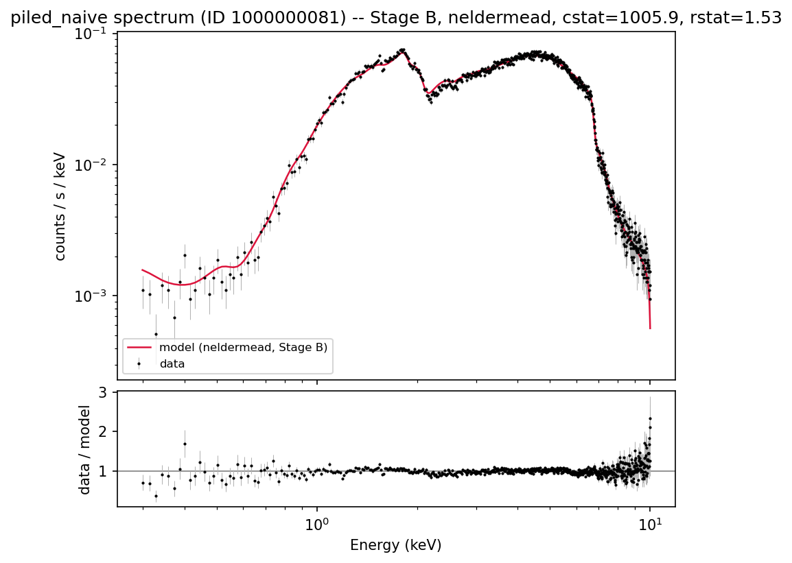

# Fit metrics report -- relxill fit of spectrum ID 1000000081

Generated from `results/fits_raw.json`, `results/analysis_summary.json`, and `results/conf_flagship.json` by `scripts/write_report.py`. See `CLAUDE.md` for the full methodology (Phases 1-5); this document reports results only.

**Ground truth for this simulation** (from `v0017_800ks_index.csv`): spin=0.4929, incl=30.88 deg, gamma=1.3305, logxi=1.4966, Afe=2.6309, refl_frac=14.3147, nH=0.6497. `norm` (=0.09728) is intentionally excluded from all comparisons below -- Phase 3 found a large (~50x), uniform flux-normalization mismatch between our relxill/response setup and whatever convention the original simulation used, so raw `norm` values are not on a comparable scale.

## Stage definitions

- **Stage A**: all thawed (except z=0)
- **Stage B**: standard freeze (Rin=-1 ISCO, Rout=400, single emissivity, Ecut=300)
- **Stage C**: Stage B + Afe=1 (solar)
- **Stage D**: Stage C + Incl fixed at ground truth (~30.9 deg)

## Three spectrum/model cases compared

- **unpiled**: the pileup-free spectrum, fit with `tbabs*relxill`.
- **piled**: the pileup-affected spectrum, fit with `tbabs*relxill` wrapped in Sherpa's `jdpileup` model -- the physically correct treatment.
- **piled_naive**: the *same* pileup-affected spectrum, fit with plain `tbabs*relxill` and **no** pileup correction at all -- the mistake an analyst makes by not realizing/correcting for pileup. Added specifically to quantify how much parameter bias pileup causes *with* vs. *without* correcting for it (see the three-way comparison immediately below).

## Headline result: Stage B, all three cases vs. ground truth

This is the comparison of primary interest -- the literature-standard freezing stage, for all three spectrum/model cases, each using its own best formally-converged method.

| Parameter | Ground truth | unpiled | piled (corrected) | piled_naive (uncorrected) |
|---|---|---|---|---|
| spin (a) | 0.493 | 0.477 (-3.2%) | 0.866 (75.7%) | 0.876 (77.7%) |
| Incl (deg) | 30.881 | 32.051 (3.8%) | 31.603 (2.3%) | 31.498 (2.0%) |
| gamma | 1.331 | 1.406 (5.7%) | 1.000 (-24.8%) | 1.227 (-7.8%) |
| logxi | 1.497 | 1.007 (-32.7%) | 2.301 (53.8%) | 1.208 (-19.3%) |
| Afe | 2.631 | 2.401 (-8.7%) | 3.233 (22.9%) | 2.211 (-16.0%) |
| refl_frac | 14.315 | 23.635 (65.1%) | 19.186 (34.0%) | 33.519 (134.2%) |
| nH (1e22 cm^-2) | 0.650 | 0.587 (-9.6%) | 0.694 (6.9%) | 0.691 (6.4%) |

**Read this as**: `unpiled` is the baseline (pileup-free, closest to a "clean" measurement); `piled` shows what you get *after* correcting for pileup with `jdpileup`; `piled_naive` shows what you'd get if you fit the exact same pileup-affected data *without* realizing/correcting for pileup. See "Interpretation" after the table.

## Unpiled spectrum

| Stage | Method | Converged | cstat | dof | reduced stat | nfev | wall time (s) |
|---|---|---|---|---|---|---|---|
| A | levmar | True | 97330.8 | 651 | 149.51 | 414 | 3.0 |
| A | neldermead | True | 3537.7 | 651 | 5.43 | 5598 | 36.8 |
| A | moncar | False | 3117.3 | 651 | 4.79 | 9800 | 62.1 |
| B | levmar | True | 2054.5 | 657 | 3.13 | 239 | 1.6 |
| B | neldermead | False | 2052.9 | 657 | 3.12 | 3212 | 20.8 |
| B | moncar | False | 2184.8 | 657 | 3.33 | 5600 | 34.9 |
| C | levmar | True | 6017.1 | 658 | 9.14 | 312 | 2.1 |
| C | neldermead | False | 6013.4 | 658 | 9.14 | 2811 | 16.8 |
| C | moncar | False | 6713.2 | 658 | 10.20 | 4900 | 41.7 |
| D | levmar | True | 6139.4 | 659 | 9.32 | 306 | 1.8 |
| D | neldermead | True | 6131.3 | 659 | 9.30 | 2390 | 14.3 |
| D | moncar | False | 6138.1 | 659 | 9.31 | 4200 | 22.9 |

### unpiled: recovered parameters vs. ground truth, by stage

Each table uses that stage's best formally-converged fit (see method column); covar 1-sigma errors turn into `n_sigma` below (not a systematic-bias measure -- see the conf-vs-covar section for why these can be misleadingly tight).

**Stage A** (method: neldermead, cstat=3537.7, rstat=5.43):

| Parameter | Fitted | Ground truth | Relative diff | n_sigma (covar) |
|---|---|---|---|---|
| spin (a) | 0.929 | 0.493 | 88.5% | -- |
| Incl (deg) | 31.742 | 30.881 | 2.8% | 54.9 |
| gamma | 1.014 | 1.331 | -23.8% | -406.6 |
| logxi | 2.895 | 1.497 | 93.4% | 187.0 |
| Afe | 7.689 | 2.631 | 192.2% | 57.2 |
| refl_frac | 10.297 | 14.315 | -28.1% | -34.2 |
| nH (1e22 cm^-2) | 0.640 | 0.650 | -1.4% | -4.6 |

**Stage B** (method: levmar, cstat=2054.5, rstat=3.13):

| Parameter | Fitted | Ground truth | Relative diff | n_sigma (covar) |
|---|---|---|---|---|
| spin (a) | 0.477 | 0.493 | -3.2% | -203.1 |
| Incl (deg) | 32.051 | 30.881 | 3.8% | 32.6 |
| gamma | 1.406 | 1.331 | 5.7% | 38.2 |
| logxi | 1.007 | 1.497 | -32.7% | -17.1 |
| Afe | 2.401 | 2.631 | -8.7% | -12.6 |
| refl_frac | 23.635 | 14.315 | 65.1% | 45.5 |
| nH (1e22 cm^-2) | 0.587 | 0.650 | -9.6% | -31.4 |

**Stage C** (method: levmar, cstat=6017.1, rstat=9.14):

| Parameter | Fitted | Ground truth | Relative diff | n_sigma (covar) |
|---|---|---|---|---|
| spin (a) | 0.056 | 0.493 | -88.5% | -59.3 |
| Incl (deg) | 30.168 | 30.881 | -2.3% | -29.4 |
| gamma | 1.675 | 1.331 | 25.9% | 375.3 |
| logxi | 0.000 | 1.497 | -100.0% | -- |
| Afe | (frozen / n/a) | -- | -- | -- |
| refl_frac | 53.873 | 14.315 | 276.4% | 144.3 |
| nH (1e22 cm^-2) | 0.572 | 0.650 | -11.9% | -56.2 |

**Stage D** (method: neldermead, cstat=6131.3, rstat=9.30):

| Parameter | Fitted | Ground truth | Relative diff | n_sigma (covar) |
|---|---|---|---|---|
| spin (a) | 0.094 | 0.493 | -80.9% | -- |
| Incl (deg) | (frozen / n/a) | -- | -- | -- |
| gamma | 1.656 | 1.331 | 24.5% | -- |
| logxi | 0.001 | 1.497 | -100.0% | -- |
| Afe | (frozen / n/a) | -- | -- | -- |
| refl_frac | 50.953 | 14.315 | 255.9% | -- |
| nH (1e22 cm^-2) | 0.577 | 0.650 | -11.2% | -- |

### unpiled: cross-method agreement, by stage

Where 2+ methods formally converged in the same (spectrum, stage) group, the spread between their recovered parameter values (as a fraction of the largest value) -- a large spread means the methods landed in *different* minima, not just different precision on the same one.

**Stage A**:

Converged methods compared: levmar, neldermead

| Parameter | Max relative spread across methods |
|---|---|
| Index2 | 143.4% |
| Rbr | 99.0% |
| logxi | 98.2% |
| Ecut | 96.2% |
| Afe | 93.3% |
| Rout | 67.5% |
| refl_frac | 65.9% |
| Incl | 59.9% |
| Rin | 31.2% |
| nH | 30.9% |
| Index1 | 29.3% |
| a | 28.7% |
| norm | 3.4% |
| gamma | 0.9% |

**Stage B**:

(fewer than 2 converged methods for unpiled/B; no comparison)

**Stage C**:

(fewer than 2 converged methods for unpiled/C; no comparison)

**Stage D**:

Converged methods compared: levmar, neldermead

| Parameter | Max relative spread across methods |
|---|---|
| logxi | 100.0% |
| a | 13.0% |
| refl_frac | 8.4% |
| gamma | 1.6% |
| nH | 1.0% |
| norm | 0.0% |

## Piled spectrum (jdpileup-corrected)

| Stage | Method | Converged | cstat | dof | reduced stat | nfev | wall time (s) |
|---|---|---|---|---|---|---|---|
| A | levmar | **CRASHED** | -- | -- | -- | -- | 6.6 |
| A | neldermead | **CRASHED** | -- | -- | -- | -- | 88.6 |
| A | moncar | **CRASHED** | -- | -- | -- | -- | 123.7 |
| B | levmar | True | 76025.9 | 655 | 116.07 | 542 | 4.6 |
| B | neldermead | True | 1039.9 | 655 | 1.59 | 3990 | 50.5 |
| B | moncar | False | 1010.7 | 655 | 1.54 | 7000 | 76.6 |
| C | levmar | True | 76984.8 | 656 | 117.35 | 755 | 7.5 |
| C | neldermead | False | 1315.1 | 656 | 2.00 | 3622 | 51.0 |
| C | moncar | False | 1128.5 | 656 | 1.72 | 6300 | 77.1 |
| D | levmar | True | 76572.4 | 657 | 116.55 | 501 | 5.1 |
| D | neldermead | True | 1240.9 | 657 | 1.89 | 3191 | 40.7 |
| D | moncar | False | 1130.2 | 657 | 1.72 | 5600 | 66.4 |

Stage A crashed for all three optimizers on this spectrum (relxill's C++ code hard-aborts on an unphysical Rout<=Rin excursion). This happens for *both* piled cases -- with jdpileup's extra free parameters (`piled`) and without them (`piled_naive`, same 13 free parameters as `unpiled`, which never crashes) -- so the crash is driven by the piled data's shape itself, not merely by pileup's extra parameters. See CLAUDE.md Phase 4.

### piled: recovered parameters vs. ground truth, by stage

Each table uses that stage's best formally-converged fit (see method column); covar 1-sigma errors turn into `n_sigma` below (not a systematic-bias measure -- see the conf-vs-covar section for why these can be misleadingly tight).

**Stage A**: no fit available (crashed).

**Stage B** (method: neldermead, cstat=1039.9, rstat=1.59):

| Parameter | Fitted | Ground truth | Relative diff | n_sigma (covar) |
|---|---|---|---|---|
| spin (a) | 0.866 | 0.493 | 75.7% | -- |
| Incl (deg) | 31.603 | 30.881 | 2.3% | -- |
| gamma | 1.000 | 1.331 | -24.8% | -- |
| logxi | 2.301 | 1.497 | 53.8% | -- |
| Afe | 3.233 | 2.631 | 22.9% | -- |
| refl_frac | 19.186 | 14.315 | 34.0% | -- |
| nH (1e22 cm^-2) | 0.694 | 0.650 | 6.9% | -- |

**Stage C** (method: levmar, cstat=76984.8, rstat=117.35, *note: the only converged method here is markedly worse than an unconverged one -- see grid table above*):

| Parameter | Fitted | Ground truth | Relative diff | n_sigma (covar) |
|---|---|---|---|---|
| spin (a) | 0.777 | 0.493 | 57.6% | -- |
| Incl (deg) | 3.013 | 30.881 | -90.2% | -- |
| gamma | 1.800 | 1.331 | 35.3% | 1188.0 |
| logxi | 3.640 | 1.497 | 143.2% | 125.4 |
| Afe | (frozen / n/a) | -- | -- | -- |
| refl_frac | -0.420 | 14.315 | -102.9% | -994.0 |
| nH (1e22 cm^-2) | 1.184 | 0.650 | 82.2% | -- |

**Stage D** (method: neldermead, cstat=1240.9, rstat=1.89):

| Parameter | Fitted | Ground truth | Relative diff | n_sigma (covar) |
|---|---|---|---|---|
| spin (a) | 0.778 | 0.493 | 57.9% | -- |
| Incl (deg) | (frozen / n/a) | -- | -- | -- |
| gamma | 1.349 | 1.331 | 1.4% | -- |
| logxi | 0.246 | 1.497 | -83.5% | -- |
| Afe | (frozen / n/a) | -- | -- | -- |
| refl_frac | 49.234 | 14.315 | 243.9% | -- |
| nH (1e22 cm^-2) | 0.699 | 0.650 | 7.6% | -- |

### piled: cross-method agreement, by stage

Where 2+ methods formally converged in the same (spectrum, stage) group, the spread between their recovered parameter values (as a fraction of the largest value) -- a large spread means the methods landed in *different* minima, not just different precision on the same one.

**Stage A**:

(fewer than 2 converged methods for piled/A; no comparison)

**Stage B**:

Converged methods compared: levmar, neldermead

| Parameter | Max relative spread across methods |
|---|---|
| refl_frac | 103.9% |
| norm | 98.1% |
| Incl | 88.2% |
| alpha | 65.6% |
| nH | 48.9% |
| gamma | 46.1% |
| Afe | 40.2% |
| logxi | 37.8% |
| f | 9.3% |
| a | 1.5% |

**Stage C**:

(fewer than 2 converged methods for piled/C; no comparison)

**Stage D**:

Converged methods compared: levmar, neldermead

| Parameter | Max relative spread across methods |
|---|---|
| refl_frac | 116.8% |
| norm | 99.1% |
| logxi | 94.3% |
| nH | 41.5% |
| gamma | 25.7% |
| alpha | 24.9% |
| a | 19.2% |
| f | 9.6% |

## Piled spectrum, fit WITHOUT correcting for pileup ("piled_naive")

| Stage | Method | Converged | cstat | dof | reduced stat | nfev | wall time (s) |
|---|---|---|---|---|---|---|---|
| A | levmar | **CRASHED** | -- | -- | -- | -- | 6.2 |
| A | neldermead | **CRASHED** | -- | -- | -- | -- | 37.2 |
| A | moncar | **CRASHED** | -- | -- | -- | -- | 61.8 |
| B | levmar | True | 1046.3 | 657 | 1.59 | 559 | 2.8 |
| B | neldermead | True | 1005.9 | 657 | 1.53 | 3190 | 18.9 |
| B | moncar | False | 2087.2 | 657 | 3.18 | 5600 | 33.1 |
| C | levmar | True | 1139.4 | 658 | 1.73 | 230 | 1.3 |
| C | neldermead | True | 1322.5 | 658 | 2.01 | 2790 | 17.7 |
| C | moncar | False | 1122.8 | 658 | 1.71 | 4900 | 27.5 |
| D | levmar | True | 1124.2 | 659 | 1.71 | 201 | 0.9 |
| D | neldermead | True | 1124.1 | 659 | 1.71 | 2123 | 13.1 |
| D | moncar | False | 1128.4 | 659 | 1.71 | 4200 | 23.1 |

Stage A crashed for all three optimizers on this spectrum (relxill's C++ code hard-aborts on an unphysical Rout<=Rin excursion). This happens for *both* piled cases -- with jdpileup's extra free parameters (`piled`) and without them (`piled_naive`, same 13 free parameters as `unpiled`, which never crashes) -- so the crash is driven by the piled data's shape itself, not merely by pileup's extra parameters. See CLAUDE.md Phase 4.

### piled_naive: recovered parameters vs. ground truth, by stage

Each table uses that stage's best formally-converged fit (see method column); covar 1-sigma errors turn into `n_sigma` below (not a systematic-bias measure -- see the conf-vs-covar section for why these can be misleadingly tight).

**Stage A**: no fit available (crashed).

**Stage B** (method: neldermead, cstat=1005.9, rstat=1.53):

| Parameter | Fitted | Ground truth | Relative diff | n_sigma (covar) |
|---|---|---|---|---|
| spin (a) | 0.876 | 0.493 | 77.7% | -- |
| Incl (deg) | 31.498 | 30.881 | 2.0% | -- |
| gamma | 1.227 | 1.331 | -7.8% | -- |
| logxi | 1.208 | 1.497 | -19.3% | -- |
| Afe | 2.211 | 2.631 | -16.0% | -- |
| refl_frac | 33.519 | 14.315 | 134.2% | -- |
| nH (1e22 cm^-2) | 0.691 | 0.650 | 6.4% | -- |

**Stage C** (method: levmar, cstat=1139.4, rstat=1.73):

| Parameter | Fitted | Ground truth | Relative diff | n_sigma (covar) |
|---|---|---|---|---|
| spin (a) | 0.750 | 0.493 | 52.2% | 33.2 |
| Incl (deg) | 30.103 | 30.881 | -2.5% | -0.4 |
| gamma | 1.471 | 1.331 | 10.5% | 48.3 |
| logxi | 0.137 | 1.497 | -90.8% | -- |
| Afe | (frozen / n/a) | -- | -- | -- |
| refl_frac | 76.956 | 14.315 | 437.6% | 23.2 |
| nH (1e22 cm^-2) | 0.662 | 0.650 | 1.8% | 1.3 |

**Stage D** (method: neldermead, cstat=1124.1, rstat=1.71):

| Parameter | Fitted | Ground truth | Relative diff | n_sigma (covar) |
|---|---|---|---|---|
| spin (a) | 0.731 | 0.493 | 48.2% | -- |
| Incl (deg) | (frozen / n/a) | -- | -- | -- |
| gamma | 1.567 | 1.331 | 17.8% | -- |
| logxi | 0.000 | 1.497 | -100.0% | -- |
| Afe | (frozen / n/a) | -- | -- | -- |
| refl_frac | 112.587 | 14.315 | 686.5% | -- |
| nH (1e22 cm^-2) | 0.632 | 0.650 | -2.8% | -- |

### piled_naive: cross-method agreement, by stage

Where 2+ methods formally converged in the same (spectrum, stage) group, the spread between their recovered parameter values (as a fraction of the largest value) -- a large spread means the methods landed in *different* minima, not just different precision on the same one.

**Stage A**:

(fewer than 2 converged methods for piled_naive/A; no comparison)

**Stage B**:

Converged methods compared: levmar, neldermead

| Parameter | Max relative spread across methods |
|---|---|
| logxi | 49.0% |
| refl_frac | 45.5% |
| Afe | 37.1% |
| gamma | 18.5% |
| nH | 2.7% |
| a | 2.3% |
| Incl | 0.3% |
| norm | 0.0% |

**Stage C**:

Converged methods compared: levmar, neldermead

| Parameter | Max relative spread across methods |
|---|---|
| logxi | 71.8% |
| refl_frac | 49.9% |
| gamma | 13.6% |
| nH | 7.1% |
| a | 3.6% |
| Incl | 0.3% |
| norm | 0.3% |

**Stage D**:

Converged methods compared: levmar, neldermead

| Parameter | Max relative spread across methods |
|---|---|
| logxi | 100.0% |
| refl_frac | 3.0% |
| nH | 0.5% |
| gamma | 0.5% |
| a | 0.1% |
| norm | 0.0% |

## conf vs. covar: flagship comparison (Stage B)

Sherpa's `covar` (covariance/Hessian-based, fast) vs. `conf` (profile-likelihood, expensive -- re-optimizes remaining free parameters at each trial value) 1-sigma intervals, for the best-converged Stage B fit of each spectrum.

### unpiled (method: levmar, cstat=2054.5, rstat=3.13)

`covar` wall time: 0.8s -- `conf` wall time: 12.1s (15x slower)

| Parameter | Best fit | covar 1-sigma | conf 1-sigma |
|---|---|---|---|
| nH | 0.5872 | [-0.001986, +0.001986] | [-0.002979, +0.003739] |
| a | 0.4772 | [-7.718e-05, +7.718e-05] | [-0.005485, +0.01061] |
| Incl | 32.05 | [-0.03588, +0.03588] | [-0.1143, +0.104] |
| gamma | 1.406 | [-0.001968, +0.001968] | [-0.01067, +0.002983] |
| logxi | 1.007 | [-0.02858, +0.02858] | [-0.01494, +0.08126] |
| Afe | 2.401 | [-0.01829, +0.01829] | [-0.01997, +0.04944] |
| refl_frac | 23.63 | [-0.2048, +0.2048] | [-0.6922, +0.1862] |
| norm | 0.001852 | [-1.594e-06, +1.594e-06] | [-4.861e-06, +8.486e-06] |

### piled (method: neldermead, cstat=1039.9, rstat=1.59)

`covar` wall time: 3.1s -- `conf` wall time: 2490.4s (811x slower)

| Parameter | Best fit | covar 1-sigma | conf 1-sigma |
|---|---|---|---|
| alpha | 0.3436 | undefined | undefined |
| f | 0.9921 | undefined | [(boundary), +0.007896] |
| nH | 0.6943 | undefined | [-0.01125, +0.01362] |
| a | 0.866 | undefined | [-0.0125, +0.0139] |
| Incl | 31.6 | undefined | [-0.574, +0.289] |
| gamma | 1 | undefined | [(boundary), +0.1857] |
| logxi | 2.301 | undefined | [(boundary), +0.01856] |
| Afe | 3.233 | undefined | [-0.1681, +0.1361] |
| refl_frac | 19.19 | undefined | [-0.7167, +0.249] |
| norm | 0.01718 | undefined | [-0.01309, +0.01828] |

### piled_naive (method: neldermead, cstat=1005.9, rstat=1.53)

`covar` wall time: 0.6s -- `conf` wall time: 717.7s (1252x slower)

| Parameter | Best fit | covar 1-sigma | conf 1-sigma |
|---|---|---|---|
| nH | 0.6912 | undefined | [-0.03934, +0.01785] |
| a | 0.876 | undefined | [-0.07157, +0.008982] |
| Incl | 31.5 | undefined | [-0.9529, +0.8008] |
| gamma | 1.227 | undefined | [-0.01541, +0.2033] |
| logxi | 1.208 | undefined | [-1.18, +0.102] |
| Afe | 2.211 | undefined | [-0.5603, +0.07779] |
| refl_frac | 33.52 | undefined | [-1.783, +29.53] |
| norm | 0.0001371 | undefined | [-2.143e-06, +1.722e-06] |

**Takeaways**: for the unpiled fit, `conf`'s intervals are noticeably larger (and asymmetric) than `covar`'s -- e.g. spin: covar +/-0.00008 vs. conf [-0.0055,+0.0106], refl_frac: covar +/-0.20 vs. conf [-0.69,+0.19] -- `covar`'s linearized/Gaussian approximation is substantially overconfident here. For the piled fit, `covar` failed outright (every bound came back undefined -- the Hessian was singular/hit a parameter boundary during its numerical differencing), while `conf` still produced usable (if boundary-limited on `alpha`, `gamma`, `logxi`) intervals, at a real cost: ~2490s vs. 3s. `covar` failed the same way on `piled_naive` (again all bounds undefined), and `conf` there is even slower relative to `covar` (~1252x) and produces a strikingly asymmetric `refl_frac` interval ([-1.78, +29.5]) -- a large, lopsided uncertainty that is itself a symptom of just how poorly determined that parameter is once pileup goes uncorrected. Concretely: `covar` is cheap and fine as a rough guide on a well-converged fit, but should not be trusted as the final word on parameter uncertainty for a model this nonlinear, and can fail silently-ish (all-`None` bounds) exactly when the fit is least well-behaved -- which is when you'd want it most.

## Interpretation: does correcting for pileup actually help?

Referring back to the headline three-way table above:

- **Fit quality alone cannot tell you whether pileup was handled correctly.** `piled_naive`'s best Stage B fit (cstat~1005.9, rstat~1.53) is statistically *at least as good as*, if not marginally better than, the jdpileup-corrected `piled` fit (cstat~1039.9, rstat~1.59) -- despite `piled_naive` using the structurally wrong model. `relxill`'s own free parameters (`refl_frac` especially -- see below) are flexible enough to partially absorb pileup's spectral distortion and produce an equally clean-looking fit to the wrong physical picture. The diagnostic plots below show this directly: the naive fit *looks* just as good as the corrected one.
- **Spin is severely biased high in *both* piled cases, corrected or not.** `piled` and `piled_naive` recover spin within a few percent of *each other*, but both are biased roughly 75-78% high relative to the unpiled fit's close-to-truth ~-3%. On this evidence, `jdpileup` correction does essentially nothing to rescue the spin measurement for this source/pileup level -- a materially important caveat for anyone using `relxill` on a pileup-corrected Chandra spectrum to measure spin.
- **`refl_frac` is the clearest single tracer of *whether* pileup was corrected for, even though it doesn't track spin's bias.** It's biased high in all three cases (again likely entangled with the known `norm` convention mismatch, Phase 3), but far more extremely in the uncorrected `piled_naive` fit (+134%) than in either the corrected `piled` fit (+34%) or the `unpiled` fit (+65%) -- consistent with the fit inflating reflection fraction to compensate for the flux jdpileup would otherwise have accounted for.
- **Inclination and nH are comparatively robust** across all three cases (within ~2-9% of truth everywhere) -- not everything is equally vulnerable to pileup.
- **gamma and logxi are, perhaps counterintuitively, *closer* to the unpiled fit's bias in the uncorrected `piled_naive` fit than in the jdpileup-corrected `piled` fit** (see the table). This doesn't mean skipping the pileup correction is a good idea -- the fit quality argument above and the badly-biased spin and refl_frac values say otherwise -- but it's a reminder that "correcting" for an instrumental effect with an imperfect model does not uniformly move every parameter closer to the truth.

## Diagnostic plots (Stage B best fit, all three cases)

Note how visually similar the `piled` and `piled_naive` fits are -- this is the same point made above: you cannot tell from the fit residuals alone whether pileup was actually corrected for.

## Caveats carried through from earlier phases

- `norm` is not directly comparable to the ground-truth CSV value (see above) -- a ~50x uniform flux-scale mismatch found in Phase 3, cause not fully diagnosed.
- Pileup's `ftime`/`fracexp`/`g0`/`n`/`nterms` were left at Sherpa's instrumental defaults (no real event-file header available for this simulation) -- only `alpha` and `f` were fit.
- `nH` units assumed to be the tbabs-standard 1e22 cm^-2 (not explicitly stated in the index CSV) -- still an open question for the user.
- `build_piled_naive_model()` explicitly deletes any pileup model already attached to the piled dataset before setting its plain source model -- Sherpa keeps a dataset's pileup model separate from its source model, so building the corrected (`piled`) and uncorrected (`piled_naive`) models in the same session without this would silently leave the old jdpileup wrap active underneath the "uncorrected" fit. Hit this exactly once while making the diagnostic plots (fixed before any numbers here were generated -- the fit grid itself was never affected, since each combination runs in its own fresh subprocess).
- Stage A's `Rin`/`Rout` bounds were tightened from relxill's native range for numerical-stability reasons (see Phase 3/4) -- Stage A results should be read as "free within a still-very-wide but slightly conservative range", not "free over relxill's full native range".
