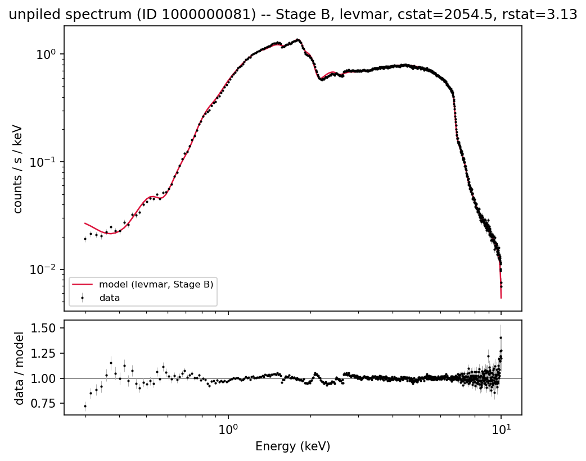
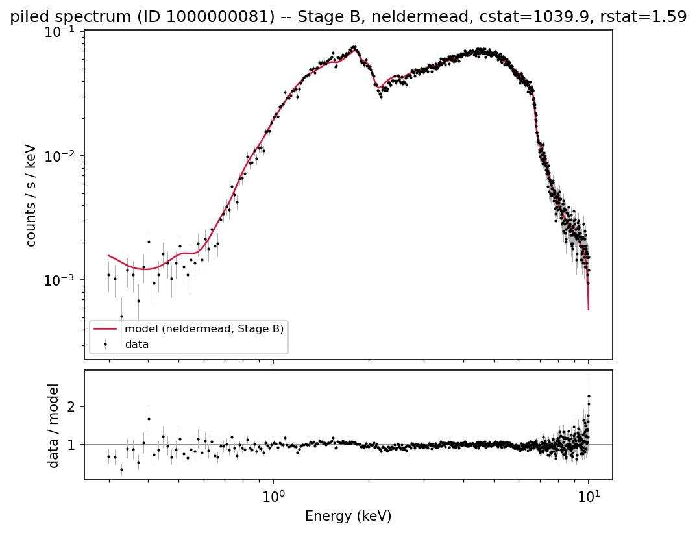

# Fit metrics report -- relxill fit of spectrum ID 1000000081

Generated from `results/fits_raw.json`, `results/analysis_summary.json`, and `results/conf_flagship.json` by `scripts/write_report.py`. See `CLAUDE.md` for the full methodology (Phases 1-5); this document reports results only.

**Ground truth for this simulation** (from `v0017_800ks_index.csv`): spin=0.4929, incl=30.88 deg, gamma=1.3305, logxi=1.4966, Afe=2.6309, refl_frac=14.3147, nH=0.6497. `norm` (=0.09728) is intentionally excluded from all comparisons below -- Phase 3 found a large (~50x), uniform flux-normalization mismatch between our relxill/response setup and whatever convention the original simulation used, so raw `norm` values are not on a comparable scale.

## Stage definitions

- **Stage A**: all thawed (except z=0)
- **Stage B**: standard freeze (Rin=-1 ISCO, Rout=400, single emissivity, Ecut=300)
- **Stage C**: Stage B + Afe=1 (solar)
- **Stage D**: Stage C + Incl fixed at ground truth (~30.9 deg)

## Unpiled spectrum

| Stage | Method | Converged | cstat | dof | reduced stat | nfev | wall time (s) |
|---|---|---|---|---|---|---|---|
| A | levmar | True | 97330.8 | 651 | 149.51 | 414 | 3.0 |
| A | neldermead | True | 3537.7 | 651 | 5.43 | 5598 | 36.8 |
| A | moncar | False | 3117.3 | 651 | 4.79 | 9800 | 62.1 |
| B | levmar | True | 2054.5 | 657 | 3.13 | 239 | 1.6 |
| B | neldermead | False | 2052.9 | 657 | 3.12 | 3212 | 20.8 |
| B | moncar | False | 2184.8 | 657 | 3.33 | 5600 | 34.9 |
| C | levmar | True | 6017.1 | 658 | 9.14 | 312 | 2.1 |
| C | neldermead | False | 6013.4 | 658 | 9.14 | 2811 | 16.8 |
| C | moncar | False | 6713.2 | 658 | 10.20 | 4900 | 41.7 |
| D | levmar | True | 6139.4 | 659 | 9.32 | 306 | 1.8 |
| D | neldermead | True | 6131.3 | 659 | 9.30 | 2390 | 14.3 |
| D | moncar | False | 6138.1 | 659 | 9.31 | 4200 | 22.9 |

### unpiled: recovered parameters vs. ground truth, by stage

Each table uses that stage's best formally-converged fit (see method column); covar 1-sigma errors turn into `n_sigma` below (not a systematic-bias measure -- see the conf-vs-covar section for why these can be misleadingly tight).

**Stage A** (method: neldermead, cstat=3537.7, rstat=5.43):

| Parameter | Fitted | Ground truth | Relative diff | n_sigma (covar) |
|---|---|---|---|---|
| spin (a) | 0.929 | 0.493 | 88.5% | -- |
| Incl (deg) | 31.742 | 30.881 | 2.8% | 54.9 |
| gamma | 1.014 | 1.331 | -23.8% | -406.6 |
| logxi | 2.895 | 1.497 | 93.4% | 187.0 |
| Afe | 7.689 | 2.631 | 192.2% | 57.2 |
| refl_frac | 10.297 | 14.315 | -28.1% | -34.2 |
| nH (1e22 cm^-2) | 0.640 | 0.650 | -1.4% | -4.6 |

**Stage B** (method: levmar, cstat=2054.5, rstat=3.13):

| Parameter | Fitted | Ground truth | Relative diff | n_sigma (covar) |
|---|---|---|---|---|
| spin (a) | 0.477 | 0.493 | -3.2% | -203.1 |
| Incl (deg) | 32.051 | 30.881 | 3.8% | 32.6 |
| gamma | 1.406 | 1.331 | 5.7% | 38.2 |
| logxi | 1.007 | 1.497 | -32.7% | -17.1 |
| Afe | 2.401 | 2.631 | -8.7% | -12.6 |
| refl_frac | 23.635 | 14.315 | 65.1% | 45.5 |
| nH (1e22 cm^-2) | 0.587 | 0.650 | -9.6% | -31.4 |

**Stage C** (method: levmar, cstat=6017.1, rstat=9.14):

| Parameter | Fitted | Ground truth | Relative diff | n_sigma (covar) |
|---|---|---|---|---|
| spin (a) | 0.056 | 0.493 | -88.5% | -59.3 |
| Incl (deg) | 30.168 | 30.881 | -2.3% | -29.4 |
| gamma | 1.675 | 1.331 | 25.9% | 375.3 |
| logxi | 0.000 | 1.497 | -100.0% | -- |
| Afe | (frozen / n/a) | -- | -- | -- |
| refl_frac | 53.873 | 14.315 | 276.4% | 144.3 |
| nH (1e22 cm^-2) | 0.572 | 0.650 | -11.9% | -56.2 |

**Stage D** (method: neldermead, cstat=6131.3, rstat=9.30):

| Parameter | Fitted | Ground truth | Relative diff | n_sigma (covar) |
|---|---|---|---|---|
| spin (a) | 0.094 | 0.493 | -80.9% | -- |
| Incl (deg) | (frozen / n/a) | -- | -- | -- |
| gamma | 1.656 | 1.331 | 24.5% | -- |
| logxi | 0.001 | 1.497 | -100.0% | -- |
| Afe | (frozen / n/a) | -- | -- | -- |
| refl_frac | 50.953 | 14.315 | 255.9% | -- |
| nH (1e22 cm^-2) | 0.577 | 0.650 | -11.2% | -- |

### unpiled: cross-method agreement, by stage

Where 2+ methods formally converged in the same (spectrum, stage) group, the spread between their recovered parameter values (as a fraction of the largest value) -- a large spread means the methods landed in *different* minima, not just different precision on the same one.

**Stage A**:

Converged methods compared: levmar, neldermead

| Parameter | Max relative spread across methods |
|---|---|
| Index2 | 143.4% |
| Rbr | 99.0% |
| logxi | 98.2% |
| Ecut | 96.2% |
| Afe | 93.3% |
| Rout | 67.5% |
| refl_frac | 65.9% |
| Incl | 59.9% |
| Rin | 31.2% |
| nH | 30.9% |
| Index1 | 29.3% |
| a | 28.7% |
| norm | 3.4% |
| gamma | 0.9% |

**Stage B**:

(fewer than 2 converged methods for unpiled/B; no comparison)

**Stage C**:

(fewer than 2 converged methods for unpiled/C; no comparison)

**Stage D**:

Converged methods compared: levmar, neldermead

| Parameter | Max relative spread across methods |
|---|---|
| logxi | 100.0% |
| a | 13.0% |
| refl_frac | 8.4% |
| gamma | 1.6% |
| nH | 1.0% |
| norm | 0.0% |

## Piled (pileup-affected) spectrum

| Stage | Method | Converged | cstat | dof | reduced stat | nfev | wall time (s) |
|---|---|---|---|---|---|---|---|
| A | levmar | **CRASHED** | -- | -- | -- | -- | 6.3 |
| A | neldermead | **CRASHED** | -- | -- | -- | -- | 86.3 |
| A | moncar | **CRASHED** | -- | -- | -- | -- | 119.4 |
| B | levmar | True | 76025.9 | 655 | 116.07 | 542 | 4.6 |
| B | neldermead | True | 1039.9 | 655 | 1.59 | 3990 | 50.5 |
| B | moncar | False | 1010.7 | 655 | 1.54 | 7000 | 76.6 |
| C | levmar | True | 76984.8 | 656 | 117.35 | 755 | 7.5 |
| C | neldermead | False | 1315.1 | 656 | 2.00 | 3622 | 51.0 |
| C | moncar | False | 1128.5 | 656 | 1.72 | 6300 | 77.1 |
| D | levmar | True | 76572.4 | 657 | 116.55 | 501 | 5.1 |
| D | neldermead | True | 1240.9 | 657 | 1.89 | 3191 | 40.7 |
| D | moncar | False | 1130.2 | 657 | 1.72 | 5600 | 66.4 |

Stage A crashed for all three optimizers (relxill's C++ code hard-aborts on an unphysical Rout<=Rin excursion, reachable even after the Stage A bound tightening once pileup's extra free parameters are added -- see CLAUDE.md Phase 4). No Stage A result exists for the piled spectrum.

### piled: recovered parameters vs. ground truth, by stage

Each table uses that stage's best formally-converged fit (see method column); covar 1-sigma errors turn into `n_sigma` below (not a systematic-bias measure -- see the conf-vs-covar section for why these can be misleadingly tight).

**Stage A**: no fit available (crashed).

**Stage B** (method: neldermead, cstat=1039.9, rstat=1.59):

| Parameter | Fitted | Ground truth | Relative diff | n_sigma (covar) |
|---|---|---|---|---|
| spin (a) | 0.866 | 0.493 | 75.7% | -- |
| Incl (deg) | 31.603 | 30.881 | 2.3% | -- |
| gamma | 1.000 | 1.331 | -24.8% | -- |
| logxi | 2.301 | 1.497 | 53.8% | -- |
| Afe | 3.233 | 2.631 | 22.9% | -- |
| refl_frac | 19.186 | 14.315 | 34.0% | -- |
| nH (1e22 cm^-2) | 0.694 | 0.650 | 6.9% | -- |

**Stage C** (method: levmar, cstat=76984.8, rstat=117.35, *note: the only converged method here is markedly worse than an unconverged one -- see grid table above*):

| Parameter | Fitted | Ground truth | Relative diff | n_sigma (covar) |
|---|---|---|---|---|
| spin (a) | 0.777 | 0.493 | 57.6% | -- |
| Incl (deg) | 3.013 | 30.881 | -90.2% | -- |
| gamma | 1.800 | 1.331 | 35.3% | 1188.0 |
| logxi | 3.640 | 1.497 | 143.2% | 125.4 |
| Afe | (frozen / n/a) | -- | -- | -- |
| refl_frac | -0.420 | 14.315 | -102.9% | -994.0 |
| nH (1e22 cm^-2) | 1.184 | 0.650 | 82.2% | -- |

**Stage D** (method: neldermead, cstat=1240.9, rstat=1.89):

| Parameter | Fitted | Ground truth | Relative diff | n_sigma (covar) |
|---|---|---|---|---|
| spin (a) | 0.778 | 0.493 | 57.9% | -- |
| Incl (deg) | (frozen / n/a) | -- | -- | -- |
| gamma | 1.349 | 1.331 | 1.4% | -- |
| logxi | 0.246 | 1.497 | -83.5% | -- |
| Afe | (frozen / n/a) | -- | -- | -- |
| refl_frac | 49.234 | 14.315 | 243.9% | -- |
| nH (1e22 cm^-2) | 0.699 | 0.650 | 7.6% | -- |

### piled: cross-method agreement, by stage

Where 2+ methods formally converged in the same (spectrum, stage) group, the spread between their recovered parameter values (as a fraction of the largest value) -- a large spread means the methods landed in *different* minima, not just different precision on the same one.

**Stage A**:

(fewer than 2 converged methods for piled/A; no comparison)

**Stage B**:

Converged methods compared: levmar, neldermead

| Parameter | Max relative spread across methods |
|---|---|
| refl_frac | 103.9% |
| norm | 98.1% |
| Incl | 88.2% |
| alpha | 65.6% |
| nH | 48.9% |
| gamma | 46.1% |
| Afe | 40.2% |
| logxi | 37.8% |
| f | 9.3% |
| a | 1.5% |

**Stage C**:

(fewer than 2 converged methods for piled/C; no comparison)

**Stage D**:

Converged methods compared: levmar, neldermead

| Parameter | Max relative spread across methods |
|---|---|
| refl_frac | 116.8% |
| norm | 99.1% |
| logxi | 94.3% |
| nH | 41.5% |
| gamma | 25.7% |
| alpha | 24.9% |
| a | 19.2% |
| f | 9.6% |

## conf vs. covar: flagship comparison (Stage B)

Sherpa's `covar` (covariance/Hessian-based, fast) vs. `conf` (profile-likelihood, expensive -- re-optimizes remaining free parameters at each trial value) 1-sigma intervals, for the best-converged Stage B fit of each spectrum.

### unpiled (method: levmar, cstat=2054.5, rstat=3.13)

`covar` wall time: 0.8s -- `conf` wall time: 12.1s (15x slower)

| Parameter | Best fit | covar 1-sigma | conf 1-sigma |
|---|---|---|---|
| nH | 0.5872 | [-0.001986, +0.001986] | [-0.002979, +0.003739] |
| a | 0.4772 | [-7.718e-05, +7.718e-05] | [-0.005485, +0.01061] |
| Incl | 32.05 | [-0.03588, +0.03588] | [-0.1143, +0.104] |
| gamma | 1.406 | [-0.001968, +0.001968] | [-0.01067, +0.002983] |
| logxi | 1.007 | [-0.02858, +0.02858] | [-0.01494, +0.08126] |
| Afe | 2.401 | [-0.01829, +0.01829] | [-0.01997, +0.04944] |
| refl_frac | 23.63 | [-0.2048, +0.2048] | [-0.6922, +0.1862] |
| norm | 0.001852 | [-1.594e-06, +1.594e-06] | [-4.861e-06, +8.486e-06] |

### piled (method: neldermead, cstat=1039.9, rstat=1.59)

`covar` wall time: 3.1s -- `conf` wall time: 2490.4s (811x slower)

| Parameter | Best fit | covar 1-sigma | conf 1-sigma |
|---|---|---|---|
| alpha | 0.3436 | undefined | undefined |
| f | 0.9921 | undefined | [(boundary), +0.007896] |
| nH | 0.6943 | undefined | [-0.01125, +0.01362] |
| a | 0.866 | undefined | [-0.0125, +0.0139] |
| Incl | 31.6 | undefined | [-0.574, +0.289] |
| gamma | 1 | undefined | [(boundary), +0.1857] |
| logxi | 2.301 | undefined | [(boundary), +0.01856] |
| Afe | 3.233 | undefined | [-0.1681, +0.1361] |
| refl_frac | 19.19 | undefined | [-0.7167, +0.249] |
| norm | 0.01718 | undefined | [-0.01309, +0.01828] |

**Takeaways**: for the unpiled fit, `conf`'s intervals are noticeably larger (and asymmetric) than `covar`'s -- e.g. spin: covar +/-0.00008 vs. conf [-0.0055,+0.0106], refl_frac: covar +/-0.20 vs. conf [-0.69,+0.19] -- `covar`'s linearized/Gaussian approximation is substantially overconfident here. For the piled fit, `covar` failed outright (every bound came back undefined -- the Hessian was singular/hit a parameter boundary during its numerical differencing), while `conf` still produced usable (if boundary-limited on `alpha`, `gamma`, `logxi`) intervals, at a real cost: ~2490s vs. 3s. Concretely: `covar` is cheap and fine as a rough guide on a well-converged fit, but should not be trusted as the final word on parameter uncertainty for a model this nonlinear, and can fail silently-ish (all-`None` bounds) exactly when the fit is least well-behaved -- which is when you'd want it most.

## Pileup bias: unpiled vs. piled, Stage B

| Parameter | Ground truth | Unpiled fit | Unpiled diff | Piled fit | Piled diff |
|---|---|---|---|---|---|
| spin (a) | 0.493 | 0.477 | -3.2% | 0.866 | 75.7% |
| Incl (deg) | 30.881 | 32.051 | 3.8% | 31.603 | 2.3% |
| gamma | 1.331 | 1.406 | 5.7% | 1.000 | -24.8% |
| logxi | 1.497 | 1.007 | -32.7% | 2.301 | 53.8% |
| Afe | 2.631 | 2.401 | -8.7% | 3.233 | 22.9% |
| refl_frac | 14.315 | 23.635 | 65.1% | 19.186 | 34.0% |
| nH (1e22 cm^-2) | 0.650 | 0.587 | -9.6% | 0.694 | 6.9% |

See the exact percentages in the table above rather than this paragraph for specific numbers. Qualitatively: both fits substantially overestimate `refl_frac` relative to truth in the same direction -- likely entangled with the known `norm` convention mismatch (Phase 3) rather than a pileup-specific effect, since it happens on the unpiled side too. Where the piled and unpiled deviations differ in sign or magnitude for a given parameter (check `Afe` and `logxi` above), that is more plausibly a genuine pileup effect: pileup distorts the spectral shape (hardening it, since low-pulse-height piled events get reassigned to higher apparent energies) in a way the `jdpileup` model only partially undoes, and that residual distortion feeds into the line/ionization parameters.

## Diagnostic plots (Stage B best fit)

## Caveats carried through from earlier phases

- `norm` is not directly comparable to the ground-truth CSV value (see above) -- a ~50x uniform flux-scale mismatch found in Phase 3, cause not fully diagnosed.
- Pileup's `ftime`/`fracexp`/`g0`/`n`/`nterms` were left at Sherpa's instrumental defaults (no real event-file header available for this simulation) -- only `alpha` and `f` were fit.
- `nH` units assumed to be the tbabs-standard 1e22 cm^-2 (not explicitly stated in the index CSV) -- still an open question for the user.
- Stage A's `Rin`/`Rout` bounds were tightened from relxill's native range for numerical-stability reasons (see Phase 3/4) -- Stage A results should be read as "free within a still-very-wide but slightly conservative range", not "free over relxill's full native range".
